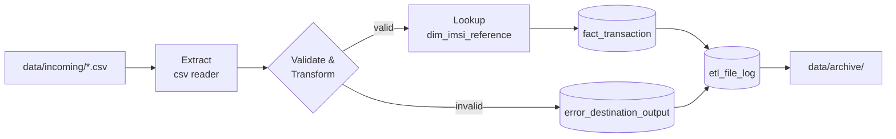

# 📡 Telecom DWH – ETL Pipeline


An ETL pipeline that loads the CSV files a telecom operator's system drops every 5 minutes into a
data-warehouse fact table. It validates and transforms each record, looks up the subscriber,
quarantines bad records together with the reason and the originating file name, and archives each
file once it has been loaded.

> Built from the *Telecom DWH* case study (see [`docs/Case_Study_Telecom_DWH.pdf`](docs/Case_Study_Telecom_DWH.pdf)).

---

## Table of Contents
- [Business Problem](#-business-problem)
- [Architecture](#-architecture)
- [Transformation Rules](#-transformation-rules)
- [Data Model](#-data-model)
- [Project Structure](#-project-structure)
- [Getting Started](#-getting-started)
- [Results on the Sample Data](#-results-on-the-sample-data)
- [Design Decisions](#-design-decisions)
- [Testing](#-testing)
- [SQL Server / SSIS Notes](#-sql-server--ssis-notes)
- [Possible Extensions](#-possible-extensions)
- [Author](#-author)

## 🎯 Business Problem

The source system emits a pipe-delimited CSV every 5 minutes containing customer transactions
(`ID | IMSI | IMEI | CELL | LAC | EVENT_TYPE | EVENT_TS`). The data is dirty (missing keys, bad timestamps,
truncated rows), so the load process must:

1. Apply validation and mapping rules before storing anything.
2. Enrich each transaction with the `subscriber_id` from an IMSI reference table.
3. Store rejected records in a separate table, tagged with the CSV file name.
4. Move each successfully processed file to an archive folder.

## 🏗 Architecture



Each file is loaded in **one database transaction** (facts + rejects + audit row). A file is moved to the
archive only after that transaction commits; if anything fails, the file stays in `incoming/` for a retry.

## 🔄 Transformation Rules

| Source column | Rule | Target |
|---|---|---|
| `ID` | As-is (must be an integer) | `transaction_id` |
| `IMSI` | As-is; **reject if null** | `imsi` |
| `IMSI` | Join to `dim_imsi_reference`; **`-99999` if not found** | `subscriber_id` |
| `IMEI` | First 8 chars; `-99999` if null or length < 14 | `tac` |
| `IMEI` | Last 6 chars; `-99999` if null or length < 14 | `snr` |
| `IMEI` | As-is (nullable) | `imei` |
| `CELL` | As-is; **reject if null** | `cell` |
| `LAC` | As-is; **reject if null** | `lac` |
| `EVENT_TYPE` | As-is (nullable) | `event_type` |
| `EVENT_TS` | Must parse as a datetime; **reject if null/invalid** | `event_ts` |

Additional guard rails (derived from the source contract's data types and lengths) also send a record to
the reject table: malformed rows (wrong field count), non-integer `ID`/`CELL`/`LAC`, `IMSI` longer than 9
characters, `IMEI` longer than 14, and `EVENT_TYPE` longer than 1 character.

## 🗄 Data Model

| Table | Purpose |
|---|---|
| `dim_imsi_reference` | IMSI → `subscriber_id` lookup (1,001 rows from the provided script) |
| `fact_transaction` | Clean, enriched transactions + `source_file` lineage |
| `error_destination_output` | Rejected records: raw values, **source file name**, line number, failing column, reason |
| `etl_file_log` | One audit row per file (rows read / loaded / rejected, SHA-256) |

Full DDL: [`src/telecom_etl/schema.sql`](src/telecom_etl/schema.sql) (SQLite) and
[`sql/sqlserver/`](sql/sqlserver/) (original T-SQL).

## 📁 Project Structure

```
telecom-dwh-etl/
├── src/telecom_etl/
│   ├── transform.py      # row-level validation & mapping rules
│   ├── pipeline.py       # extract → transform → load → archive
│   ├── cli.py            # command-line interface (+ --watch mode)
│   └── schema.sql        # warehouse DDL
├── data/
│   ├── sample/           # 13 sample CSVs from the case study
│   ├── reference/        # dim_imsi_reference.csv
│   ├── incoming/         # drop zone polled by the pipeline
│   └── archive/          # successfully processed files
├── sql/
│   ├── sqlserver/        # original T-SQL scripts from the case materials
│   └── sample_queries.sql
├── tests/                # pytest suite
├── docs/                 # case study PDF
└── README.md
```

## 🚀 Getting Started

**Requirements:** Python 3.10+ (no third-party packages are needed to run the pipeline).

```bash
git clone <this-repo-url>
cd telecom-dwh-etl

# 1. Drop some files into the incoming folder
cp data/sample/*.csv data/incoming/

# 2. Run the pipeline
PYTHONPATH=src python3 -m telecom_etl

# 3. Inspect the result (SQLite file: warehouse/telecom_dwh.db)
python3 -c "import sqlite3; c=sqlite3.connect('warehouse/telecom_dwh.db'); \
print(c.execute('select * from etl_file_log').fetchall())"
```

Run continuously, polling every 5 minutes like the source system:

```bash
PYTHONPATH=src python3 -m telecom_etl --watch 300
```

Options: `--incoming`, `--archive`, `--db`, `--reference` (run with `-h` for details).
More inspection queries are in [`sql/sample_queries.sql`](sql/sample_queries.sql).

## 📊 Results on the Sample Data

Running all 13 sample files:

| Metric | Value |
|---|---|
| Records read | 1,832 |
| Loaded to `fact_transaction` | **1,737** |
| Rejected to `error_destination_output` | **95** |
| Loaded rows with unknown IMSI (`subscriber_id = -99999`) | 733 |
| Files archived | 13 / 13 |

Rejection breakdown:

| Column | Reason | Records |
|---|---|---:|
| EVENT_TS | null | 30 |
| IMSI | null | 29 |
| CELL | null | 24 |
| IMSI | longer than 9 characters | 5 |
| LAC | null | 4 |
| ID | not an integer | 2 |
| ROW | malformed (truncated) record | 1 |

A second run does nothing: files already loaded are detected by name + SHA-256, so they are never
double-loaded.

## 🧠 Design Decisions

- **Timestamp formats.** The sources mix `dd/MM/yyyy HH:mm`, `d/M/yyyy H:mm:ss` and `M/d/yyyy H:mm:ss`.
  Day-first is tried first (the case study's convention), month-first is the fallback. A date such as
  `06/07/2020` is therefore read as 6 July; this ambiguity should be confirmed with the data owner.
- **Line endings.** Source files use bare CR line endings; Python's `csv` module with `newline=""` handles
  this transparently.
- **Idempotency.** Re-delivered identical files are skipped (and archived under a numbered name, never
  overwritten). Transaction IDs are *not* de-duplicated across different files, because the case study
  defines no business key.
- **Atomic per-file loads.** A failure mid-file rolls back that file only; other files continue.
- **Raw rejects.** The reject table stores raw text so a bad value can never break the reject insert itself.

## ✅ Testing

```bash
pip install -r requirements-dev.txt
python3 -m pytest
```

24 tests cover every mapping/rejection rule, all supported timestamp formats, end-to-end loading,
archiving, idempotency and failure handling.

## 🧩 SQL Server / SSIS Notes

The case materials target SQL Server (`SSIS_Telecom_DB`), and the original scripts are preserved in
[`sql/sqlserver/`](sql/sqlserver/). This repository implements the same data flow in Python so it runs
anywhere without a SQL Server licence: Flat File Source → Derived Column / Conditional Split →
Lookup (`dim_imsi_reference`) → OLE DB Destination, with the error output redirected to
`error_destination_output` and a File System Task archiving the file. Swapping SQLite for SQL Server only
requires changing the connection and DDL dialect in `pipeline.py` / `schema.sql`.

## 🔭 Possible Extensions

- Date/time and device (TAC) dimensions for a full star schema
- Reject-rate alerting and data-quality dashboards
- Orchestration with Airflow or cron instead of `--watch`
- Quarantine folder for files that fail structurally (e.g. bad header)

## 👤 Author

**Marshlino Nader** – Computer Engineering student, Pharos University in Alexandria
[LinkedIn](https://linkedin.com/in/marshlino-nader-954794363)

Released under the [MIT License](LICENSE).
